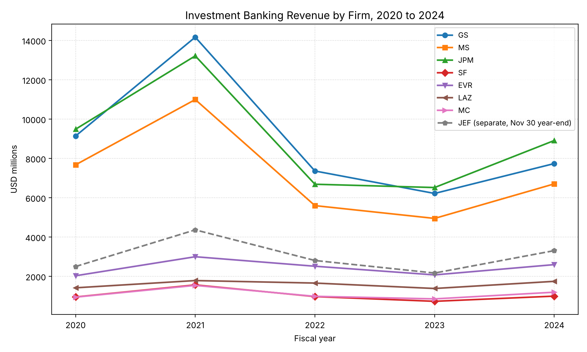
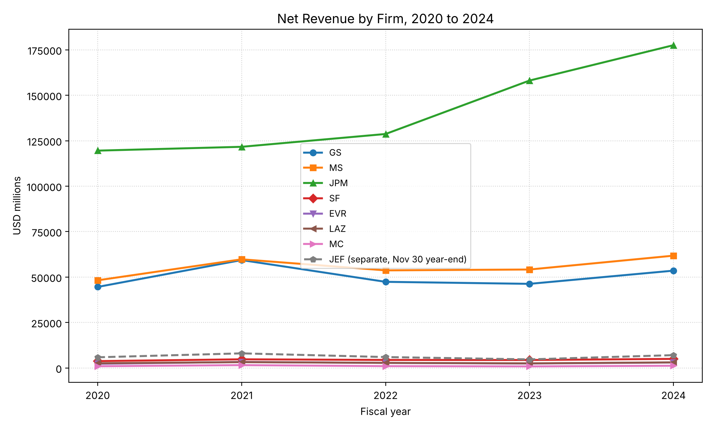
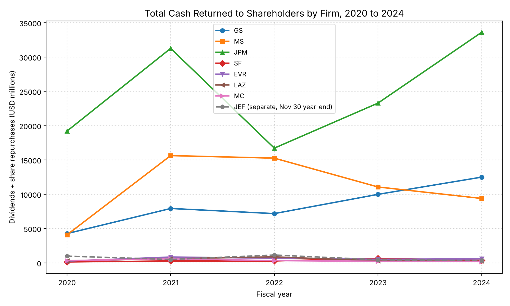
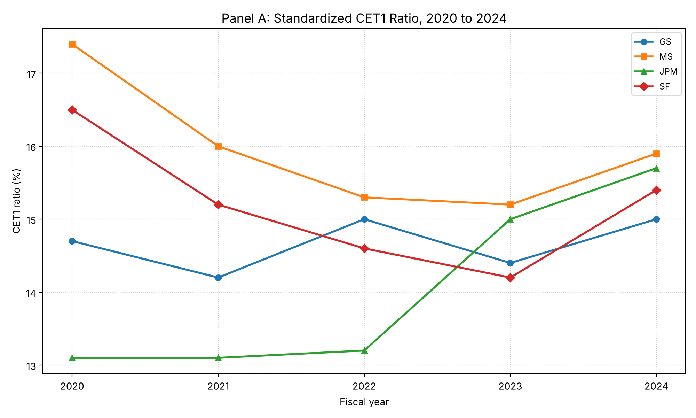
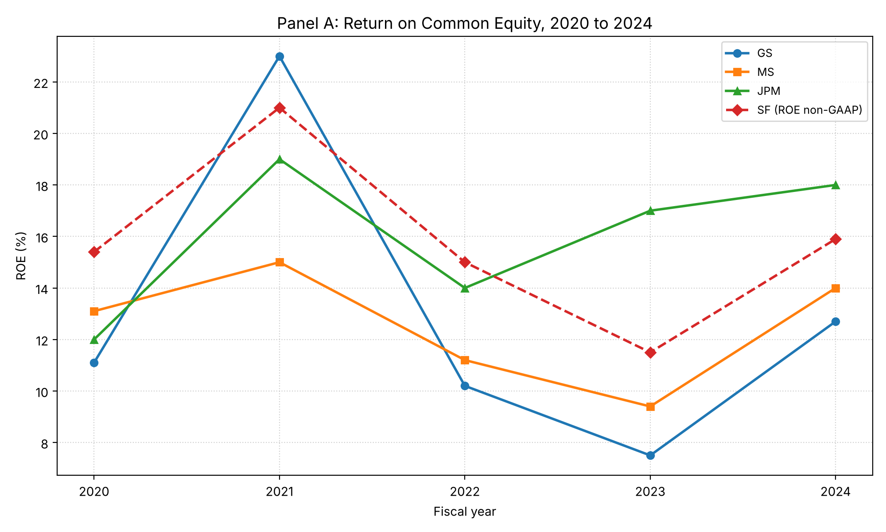
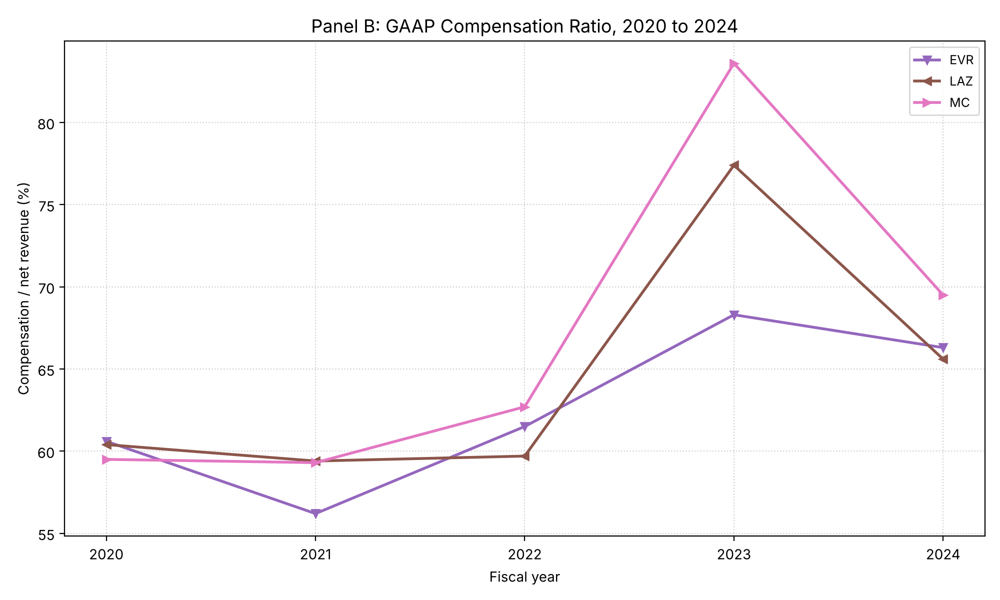
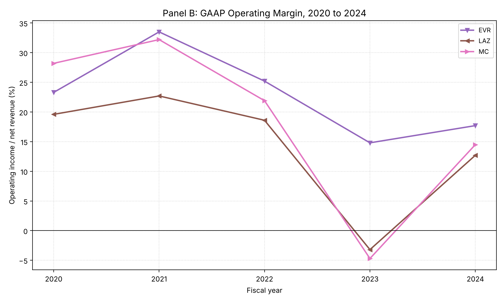
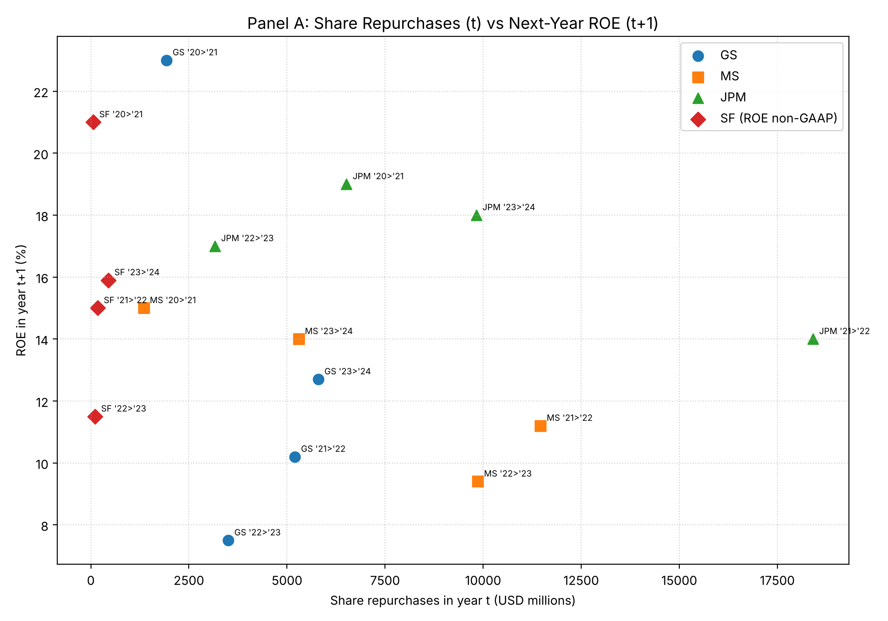
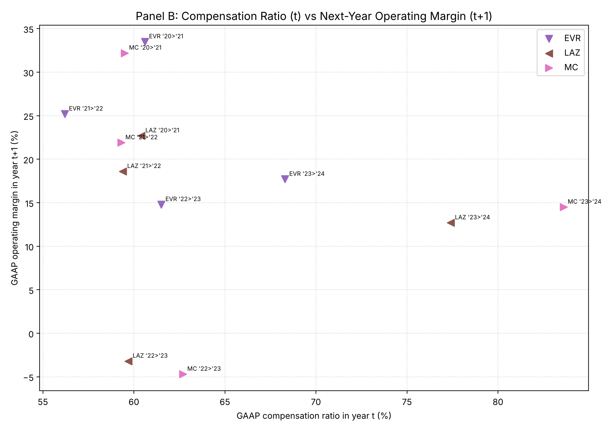

# Strategic Capital Allocation in Investment Banking: A Comparative Study of Eight U.S. Firms, 2020 to 2024

**Author**: Ege Umut Can  
**School**: FMV Işık High School, Istanbul (Class of 2027)  
**Type**: Independent high-school research project  
**Date**: September 2026 (data corrected and analysis rerun in November 2026)  
**Primary data source**: SEC filings (Form 10-K annual reports)

---

## 1. Abstract

I studied how eight U.S. investment-banking and advisory firms divided their money between paying shareholders, keeping capital and running the business from 2020 to 2024, and whether these choices were linked to performance in the following year. Panel A has four bank holding companies (Goldman Sachs, Morgan Stanley, JPMorgan Chase, Stifel Financial). Panel B has three advisory boutiques (Evercore, Lazard, Moelis & Company). Jefferies is kept separate as a comparison case. The first version of my dataset contained transcription errors, so I re-collected 380 values from SEC filings and reran every table, chart and test on the corrected data.

The eight firms returned $233.3 billion to shareholders: $113.9 billion in dividends and $119.5 billion in buybacks. Bank dividends rose over the period, while buybacks changed a lot from year to year. Goldman Sachs, Morgan Stanley and JPMorgan Chase reported standardized CET1 ratios between 13.1% and 17.4%; Stifel's were between 14.2% and 16.5%. At the boutiques, GAAP compensation took 56.2% to 59.4% of net revenue in 2021 and 68.3% to 83.6% in 2023. Operating margins fell from 22.7% to 33.5% in 2021 to between -4.7% and 14.8% in 2023, and Lazard and Moelis made GAAP operating losses in 2023.

In a one-year lagged test, Panel A buybacks had a weak negative and not significant link with next-year return on equity (Pearson r = -0.246, p = 0.359; Spearman rho = -0.324; N = 16). In Panel B, buybacks also had a weak negative and not significant link with next-year operating margin (r = -0.254, p = 0.426; N = 12). So I found no clear link between buybacks and later performance in either panel. The samples are small, the period is short and unusual, I ran 24 tests without a multiple-testing correction, and I have no data on how managers made decisions, so none of these results show cause and effect.

---

## 2. Introduction

Capital allocation is how a firm decides what to do with the money it earns: put it back into the business, keep it as a buffer against losses, or pay it to shareholders through dividends and buybacks.

I chose investment banking because 2020 to 2024 moved through very different conditions:

1. 2020: the COVID-19 pandemic, followed by government stimulus and emergency Federal Reserve action.
2. 2021: a boom in mergers and acquisitions (M&A), IPOs and debt issuance, with very high fee revenue.
3. 2022 and 2023: the Federal Reserve raised rates by more than 500 basis points, and underwriting and advisory activity fell.
4. 2024: deal activity began to recover, while regulators debated the proposed Basel III Endgame capital rules.

The firms are not built the same way. Bank holding companies take deposits, make loans and must keep regulatory capital under Federal Reserve supervision. Advisory boutiques mainly sell advice and depend on their bankers rather than their balance sheet. So "dollars spent on buybacks" may mean something different in each.

> **Research question**: How do major investment-banking firms allocate capital between business investment, capital retention and shareholder distributions, and how are these patterns associated with later business performance?

This is an observational study. I did not run regressions or try to prove causes; I recorded what the filings show and kept data and opinion apart.

---

## 3. Research Questions and Framework

1. **Dividends and buybacks**: How did they change over 2020 to 2024?
2. **Capital and cost flexibility**: What capital ratios did the banks keep, and how did the boutiques' compensation ratios change in the downturn?
3. **Lagged associations**: Were capital-allocation choices in year t associated with performance in year t+1, and did this differ between panels?

I organised my thinking with this chain:

```
Financial conditions (deal cycle, interest rates, regulation, fee revenue)
        |
        v
Decision considerations (NOT observed: risk tolerance, keeping staff, liquidity needs)
        |
        v
Capital-allocation decisions (dividends, buybacks, pay pools, retained capital)
        |
        v
Observable outputs (dividends paid, buybacks, CET1, compensation ratio, margins, ROE)
```

This is not a tested model. My data cover only the first and last boxes. A 10-K does not record board discussions or management's reasons, so whenever I talk about decisions it is interpretation, not measured fact.

---

## 4. Research Design

### 4.1 Firms and panels

I chose major U.S. investment-banking and advisory firms that reported under U.S. GAAP for all five years. Pooling all eight would mix very different businesses, so I used two panels and one separate comparison firm.

**Table 1: Firms and panels**

| Ticker | Firm | Panel | Business model | Fiscal year-end |
| :--- | :--- | :--- | :--- | :--- |
| GS | The Goldman Sachs Group, Inc. | A | Bank holding company, Category I G-SIB | Dec 31 |
| MS | Morgan Stanley | A | Bank holding company, Category I G-SIB | Dec 31 |
| JPM | JPMorgan Chase & Co. | A | Bank holding company, Category I G-SIB | Dec 31 |
| SF | Stifel Financial Corp. | A | Financial holding company, Category IV | Dec 31 |
| EVR | Evercore Inc. | B | Independent advisory boutique | Dec 31 |
| LAZ | Lazard, Inc. | B | Advisory and asset management (C-Corporation from 2024) | Dec 31 |
| MC | Moelis & Company | B | Independent advisory boutique | Dec 31 |
| JEF | Jefferies Financial Group Inc. | Separate | Broker-dealer and investment bank | Nov 30 |

Jefferies is outside both panels because its year ends on 30 November and it falls under SEC broker-dealer capital rules (Rule 15c3-1), not Federal Reserve bank holding company rules. It appears in the revenue and payout tables but not in the lagged tests.

### 4.2 Period and methods

The study covers fiscal years 2020 to 2024, giving four transitions: 2020 to 2021 (pandemic to boom), 2021 to 2022 (peak to rate rises), 2022 to 2023 (weak underwriting and banking stress) and 2023 to 2024 (early recovery).

1. **Descriptive analysis**: levels and changes in revenue, payouts, capital and margins for each firm.
2. **Lagged analysis**: I paired a capital-allocation measure in year t with a performance measure in year t+1 and calculated the Pearson correlation (r) and the Spearman rank correlation (rho). Spearman uses ranks, so it is less affected by one or two extreme values, which matters in small samples.

### 4.3 Variables

I used revenue (net revenue, investment-banking revenue), payout (dividends, buybacks), capital (standardized CET1 and supplementary leverage ratios), performance (ROE, efficiency ratio, operating income and margin, compensation ratio) and, for the boutiques, cash and funded debt. Appendix A gives the definitions.

---

## 5. Data and Provenance

### 5.1 Data correction

The first version of the dataset contained transcription errors. For example, for Stifel, Evercore, Lazard and Jefferies I had recorded total revenues before interest expense instead of net revenue; the Morgan Stanley ROE values were not ROE; the boutiques' compensation ratios and operating margins did not match the firms' GAAP figures; Evercore's senior notes were recorded as zero debt; and Stifel's CET1 ratios were wrong. I therefore re-collected all values used in the analysis from SEC filings in November 2026. The corrected values, with the filing term used and a source link for each one, are in `corrected_raw.csv`. All tables, charts and correlations in this paper were recalculated from that file, and several findings of the first version changed (Sections 6 and 7).

### 5.2 Dataset

The corrected dataset has 380 re-collected values for the eight firms over 2020 to 2024. Each value has a status label: **VERIFIED_SEC** (375 values, checked against the filing) and **NOT_APPLICABLE** (5, Stifel's supplementary leverage ratio, which Stifel does not report; not treated as zero). Variables from the first version that I did not re-collect are kept in the file with the label **NOT_RECOLLECTED** and are not used anywhere in this paper: return on tangible common equity, tangible common equity, the Tier 1 leverage ratio, technology spending, the banks' cash and debt, and Jefferies's ROE, efficiency ratio and capital ratios.

I calculated these derived values (`corrected_derived.csv`):

- Total cash returned = cash dividends paid + share repurchases
- Shareholder distribution ratio = total cash returned / net revenue
- Net liquid cushion = cash and cash equivalents - funded long-term debt (Panel B)

For Panel B I used the operating margins the firms report on a GAAP basis (operating income / net revenue).

### 5.3 Definitions and caveats

- **Share repurchases, Panel A.** For Goldman Sachs, Morgan Stanley and JPMorgan Chase I used figures that exclude shares withheld to cover employees' tax when stock awards vest. Goldman Sachs and Stifel show the withholding as a separate cash-flow line. Morgan Stanley's cash-flow line includes it, so for Morgan Stanley I used the Share Repurchase Program figure from the filing instead (the cash-flow figure is recorded in `corrected_raw.csv`). JPMorgan Chase's cash-flow line does not mention tax withholding and shows no separate line. Using Morgan Stanley's cash-flow figure instead changes the main Panel A result very little (r = -0.265, p = 0.322).
- **Share repurchases, Panel B.** The boutiques do not report on one basis. Lazard's figure excludes tax withholding; Evercore's includes it and also includes purchases of noncontrolling interests; Moelis's cash-flow statement does not split it out. Moelis's dividend line also includes tax distributions to its partnership unitholders. So Panel B payout figures are less comparable than Panel A's.
- **Stifel.** Stifel reports full-year return on common equity only on a non-GAAP basis, so its ROE is not directly comparable with the GAAP ROE of the other three banks. Stifel also does not report an efficiency ratio; as a substitute I used the GAAP expense percentage from its 10-K results table, which is defined differently from the other banks' efficiency ratios. I kept Stifel in Panel A, but both caveats apply to every Panel A result that uses ROE or the efficiency ratio.
- **Operating income, Panel B.** Lazard's GAAP operating income equals its income before income taxes; Evercore's is net revenues less total expenses.
- **Recast figures.** Some 2020 and 2021 values are as originally reported; later filings recast a few of them (for example Goldman Sachs's investment-banking revenue). I kept the originally reported figures.

---

## 6. Descriptive Findings

### 6.1 Revenue

All eight firms had higher net revenue in 2024 than in 2020, from +18.9% at Lazard to +48.5% at JPMorgan Chase (Table 2, Figure 3).

**Table 2: Net revenue, 2020 to 2024 (USD millions)**

| Ticker | Panel | 2020 | 2021 | 2022 | 2023 | 2024 | Change 2020 to 2024 |
| :--- | :--- | ---: | ---: | ---: | ---: | ---: | ---: |
| GS | A | 44,560.0 | 59,339.0 | 47,365.0 | 46,254.0 | 53,512.0 | +20.1% |
| MS | A | 48,198.0 | 59,755.0 | 53,668.0 | 54,143.0 | 61,761.0 | +28.1% |
| JPM | A | 119,543.0 | 121,649.0 | 128,695.0 | 158,104.0 | 177,556.0 | +48.5% |
| SF | A | 3,752.1 | 4,737.1 | 4,391.4 | 4,348.9 | 4,970.3 | +32.5% |
| EVR | B | 2,263.9 | 3,289.5 | 2,762.0 | 2,425.9 | 2,979.6 | +31.6% |
| LAZ | B | 2,566.1 | 3,193.0 | 2,773.6 | 2,515.5 | 3,051.8 | +18.9% |
| MC | B | 943.3 | 1,540.6 | 985.3 | 854.7 | 1,194.5 | +26.6% |
| JEF | Separate | 5,850.5 | 8,013.8 | 5,978.8 | 4,700.4 | 7,034.8 | +20.2% |

JPMorgan Chase grew from $119.5 billion to $177.6 billion (+48.5%). I think part of this came from higher net interest income after the Federal Reserve's 525-basis-point rate rises and part from its purchase of First Republic Bank in May 2023, but my data do not separate the two.

Investment-banking revenue peaked in 2021 at every firm (Figure 1), for example $14,168M at Goldman Sachs, $13,216M at JPMorgan Chase, $2,998.7M at Evercore and $1,540.6M at Moelis. By 2023 it had fallen to $6,218M, $6,519M, $2,074.9M and $854.7M respectively. In 2024 the boutiques' investment-banking revenue was above its 2020 level (+27.9% at Evercore, +23.2% at Lazard, +26.6% at Moelis), while at Goldman Sachs (-15.4%), Morgan Stanley (-12.6%) and JPMorgan Chase (-6.1%) it was still below 2020.


*Figure 1: Investment-banking revenue by firm (USD millions, 2020 to 2024). Source: SEC filings, `corrected_raw.csv`.*


*Figure 3: Net revenue by firm (USD millions, 2020 to 2024). Source: SEC filings, `corrected_raw.csv`.*

### 6.2 Dividends and buybacks

Over the five years the eight firms returned **$233.3 billion** to shareholders: $113.9 billion in cash dividends (48.8%) and $119.5 billion in share repurchases (51.2%).

**Table 3: Shareholder distributions, 2020 to 2024 (USD millions)**

| Ticker | 5-year dividends | 5-year buybacks | 5-year total | Dividend change 2020 to 2024 | Yearly buyback range |
| :--- | ---: | ---: | ---: | ---: | :--- |
| GS | 17,429.0 | 24,424.0 | 41,853.0 | +92.5% | $1.9B to $8.0B |
| MS | 24,212.0 | 31,226.0 | 55,438.0 | +124.1% | $1.3B to $11.5B |
| JPM | 67,356.0 | 56,741.0 | 124,097.0 | +16.5% | $3.2B to $18.8B |
| SF | 774.3 | 924.8 | 1,699.1 | +208.1% | $58M to $444M |
| EVR | 616.4 | 2,269.9 | 2,886.3 | +27.4% | $147M to $730M |
| LAZ | 926.5 | 1,354.6 | 2,281.1 | -9.0% | $60M to $692M |
| MC | 1,304.0 | 353.8 | 1,657.8 | -34.9% | $11M to $148M |
| JEF | 1,245.4 | 2,159.6 | 3,405.0 | +88.3% | $44M to $860M |

1. **Dividends** rose at all four banks: Goldman Sachs from $2,336M to $4,497M, Morgan Stanley from $2,739M to $6,138M, JPMorgan Chase from $12,690M to $14,783M and Stifel from $73.8M to $227.3M. Only JPMorgan Chase had a small dip (in 2023). The boutiques were mixed: Evercore's dividends rose, but Lazard's and Moelis's fell (Moelis paid $480.0M in 2021 and $174.7M in 2022; its figure includes tax distributions to unitholders, Section 5.3).
2. **Buybacks** moved much more (Figure 2). In 2021, the strongest revenue year, they jumped at JPMorgan Chase ($6,517M to $18,408M), Morgan Stanley ($1,347M to $11,464M) and Goldman Sachs ($1,928M to $5,200M). After that the paths split. Morgan Stanley cut buybacks every year, to $3,250M in 2024. JPMorgan Chase fell to $3,162M in 2022 and then rose to $18,830M in 2024. Goldman Sachs bought back more in 2023 ($5,796M) and 2024 ($8,000M), even though its ROE fell to 7.5% in 2023. So buybacks were high in the boom year, but after that they did not simply follow revenue or profit.


*Figure 2: Total cash returned to shareholders by firm (USD millions, 2020 to 2024). Source: SEC filings, `corrected_raw.csv`.*

### 6.3 Bank capital ratios and returns (Panel A)

**Table 4: Panel A standardized CET1 ratio, ROE and efficiency ratio (%)**

| Ticker | Measure | 2020 | 2021 | 2022 | 2023 | 2024 | 5-year mean |
| :--- | :--- | ---: | ---: | ---: | ---: | ---: | ---: |
| GS | CET1 | 14.7 | 14.2 | 15.0 | 14.4 | 15.0 | 14.66 |
| GS | ROE | 11.1 | 23.0 | 10.2 | 7.5 | 12.7 | 12.90 |
| GS | Efficiency ratio | 65.0 | 53.8 | 65.8 | 74.6 | 63.1 | 64.46 |
| MS | CET1 | 17.4 | 16.0 | 15.3 | 15.2 | 15.9 | 15.96 |
| MS | ROE | 13.1 | 15.0 | 11.2 | 9.4 | 14.0 | 12.54 |
| MS | Efficiency ratio | 70.1 | 67.0 | 73.0 | 77.0 | 71.0 | 71.62 |
| JPM | CET1 | 13.1 | 13.1 | 13.2 | 15.0 | 15.7 | 14.02 |
| JPM | ROE | 12.0 | 19.0 | 14.0 | 17.0 | 18.0 | 16.00 |
| JPM | Efficiency ratio | 56.0 | 59.0 | 59.0 | 55.0 | 52.0 | 56.20 |
| SF | CET1 | 16.5 | 15.2 | 14.6 | 14.2 | 15.4 | 15.18 |
| SF | ROE (non-GAAP) | 15.4 | 21.0 | 15.0 | 11.5 | 15.9 | 15.76 |
| SF | Expense ratio (substitute) | 82.6 | 77.5 | 79.8 | 83.8 | 81.3 | 81.00 |

For Goldman Sachs, Morgan Stanley and JPMorgan Chase, CET1 ratios stayed between 13.1% and 17.4% (Figure 4). Morgan Stanley had the highest average (15.96%) but fell from 17.4% to 15.9%; JPMorgan Chase rose from 13.1% to 15.7%. Stifel's CET1 ratio was between 14.2% and 16.5%, higher than Goldman Sachs's and JPMorgan Chase's in most years. The first version of this paper said Stifel had the lowest ratios (about 11%); that was a data error.

Supplementary leverage ratios at the three G-SIBs were higher in 2020 (6.9% to 7.4%), when a temporary Federal Reserve rule left U.S. Treasuries and central bank deposits out of the calculation. After the rule expired on 31 March 2021, they were between 5.4% and 6.1%.

ROE peaked in 2021 at all four banks, from 15.0% at Morgan Stanley to 23.0% at Goldman Sachs (Figure 5). In 2023 it fell to 7.5% at Goldman Sachs, 9.4% at Morgan Stanley and 11.5% at Stifel, while JPMorgan Chase's rose to 17.0%. In 2024 it ranged from 12.7% to 18.0%. JPMorgan Chase had the lowest efficiency ratio in every year except 2021 (52.0% to 59.0%; a lower ratio means costs take a smaller share of revenue).


*Figure 4: Standardized CET1 ratios for Panel A (2020 to 2024). Source: SEC filings, `corrected_raw.csv`.*


*Figure 5: Return on common equity (%) for Panel A (2020 to 2024); Stifel's is non-GAAP. Source: SEC filings, `corrected_raw.csv`.*

### 6.4 Boutique compensation and margins (Panel B)

**Table 5: Panel B GAAP compensation ratio and operating margin (%)**

| Ticker | Measure | 2020 | 2021 | 2022 | 2023 | 2024 | 5-year mean |
| :--- | :--- | ---: | ---: | ---: | ---: | ---: | ---: |
| EVR | Compensation ratio | 60.6 | 56.2 | 61.5 | 68.3 | 66.3 | 62.6 |
| EVR | Operating margin | 23.3 | 33.5 | 25.2 | 14.8 | 17.7 | 22.9 |
| LAZ | Compensation ratio | 60.4 | 59.4 | 59.7 | 77.4 | 65.6 | 64.5 |
| LAZ | Operating margin | 19.6 | 22.7 | 18.6 | -3.2 | 12.7 | 14.1 |
| MC | Compensation ratio | 59.5 | 59.3 | 62.7 | 83.6 | 69.5 | 66.9 |
| MC | Operating margin | 28.2 | 32.2 | 21.9 | -4.7 | 14.5 | 18.4 |

Pay is the boutiques' biggest cost (Figure 6). In 2021 compensation ratios were 56.2% to 59.4%; in 2023 they rose to 68.3% at Evercore, 77.4% at Lazard and 83.6% at Moelis. From 2022 to 2023 net revenue fell by 12.2% at Evercore, 9.3% at Lazard and 13.3% at Moelis. Compensation did not follow it down: it fell only 2.4% at Evercore ($1,697.5M to $1,656.9M) and it rose 17.5% at Lazard ($1,656.5M to $1,946.0M) and 15.6% at Moelis ($618.2M to $714.7M).

Operating margins moved the other way (Figure 7): 22.7% to 33.5% in 2021, then 14.8% (Evercore), -3.2% (Lazard) and -4.7% (Moelis) in 2023, and 12.7% to 17.7% in 2024. Lazard had a GAAP operating loss of $80.0M in 2023 and Moelis one of $40.4M. I did not study in the filings what made up the higher 2023 pay costs, so I cannot say why compensation rose at two firms while revenue fell. What the data do show is that in the 2023 slowdown the boutiques did not cut pay in line with revenue, and the fall in revenue showed up in much lower margins, and at two firms in losses.


*Figure 6: GAAP compensation ratio (%) for Panel B (2020 to 2024). Source: SEC filings, `corrected_raw.csv`.*


*Figure 7: GAAP operating margin (%) for Panel B (2020 to 2024). Source: SEC filings, `corrected_raw.csv`.*

### 6.5 Balance sheets

Moelis had no funded debt in any year; its cash was between $186.4M and $520.2M ($412.5M in 2024). Evercore, which the first version wrongly showed as debt-free, carried senior notes of $371.8M to $376.5M; with cash of $578.3M to $873.0M its net liquid cushion was positive every year ($202.1M to $499.1M). Lazard carried senior notes averaging $1,686.6M against average cash of $1,273.8M, so its net liquid cushion was negative every year (between -$220.2M and -$718.9M). I think this reflects its asset-management business. The banks fund themselves with deposits, repurchase agreements and long-term debt as part of their lending and trading, so I did not compare their cash and debt with the boutiques'.

---

## 7. Comparative and Lagged Analysis

### 7.1 Why the panels are analysed separately

For a bank, capital is the regulatory buffer that absorbs losses, and payouts are limited by the Federal Reserve's annual stress tests (CCAR). For a boutique, capital is mainly cash to pay staff through slow periods, and its board faces no bank capital rules. Banks also have large non-pay costs such as interest, credit provisions and technology, while boutique costs are mostly compensation. Pooling the two would mix these differences.

### 7.2 Lagged associations (t to t+1)

Each firm gives four pairs (2020 to 2021 through 2023 to 2024), so N = 16 for Panel A (4 firms x 4) and N = 12 for Panel B (3 firms x 4). I tested 24 pairs in total (12 per panel; all are in `corrected_correlations.csv`). Table 6 shows nine of them.

**Table 6: Selected lagged associations (t to t+1)**

| Panel | Year t measure | Year t+1 outcome | N | Pearson r | p | Spearman rho | p |
| :--- | :--- | :--- | ---: | ---: | ---: | ---: | ---: |
| A | Share repurchases | ROE | 16 | -0.246 | 0.359 | -0.324 | 0.221 |
| A | Cash dividends paid | ROE | 16 | +0.160 | 0.555 | -0.025 | 0.927 |
| A | Cash dividends paid | Efficiency ratio | 16 | -0.749 | 0.001 | -0.696 | 0.003 |
| A | Standardized CET1 | ROE | 16 | -0.046 | 0.865 | -0.113 | 0.677 |
| B | Share repurchases | Operating margin | 12 | -0.254 | 0.426 | -0.189 | 0.557 |
| B | Total cash returned | Operating margin | 12 | -0.225 | 0.481 | -0.070 | 0.829 |
| B | Compensation ratio | Operating margin | 12 | -0.206 | 0.520 | -0.545 | 0.067 |
| B | IB revenue | Operating income | 12 | +0.438 | 0.155 | +0.441 | 0.152 |
| B | Distribution ratio | Operating income | 12 | -0.661 | 0.019 | -0.622 | 0.031 |

### 7.3 Results

1. **Panel A, buybacks and next-year ROE**: weak and negative, not significant (r = -0.246, p = 0.359; rho = -0.324; Figure 8). In this sample there is no clear link between buybacks and next-year ROE. The first version reported r = -0.049; the direction is the same, but the corrected value is somewhat more negative, mainly because the corrected Morgan Stanley ROE values are lower and Stifel's (non-GAAP) values are higher, and Stifel made small buybacks.
2. **Panel A, dividends and next-year efficiency ratio**: strongly negative (r = -0.749, p = 0.001; rho = -0.696, p = 0.003). This is now the strongest result in the study, but I do not read it as a year-to-year link. It mostly reflects differences between firms: Stifel pays by far the smallest dividends and its substitute expense ratio (77.5% to 83.8%) sits well above the other banks' efficiency ratios, while JPMorgan Chase pays the largest dividends and has the lowest ratios. Without Stifel the result is much weaker (r = -0.579, p = 0.048; rho = -0.340, p = 0.280). Because Stifel's ratio is defined differently (Section 5.3), part of this result may come from the measure, not from the firms.
3. **Panel A, dividends and next-year ROE, and CET1 and next-year ROE**: both close to zero (r = +0.160 and r = -0.046). The first version reported a small positive link for CET1 (r = +0.174); with corrected data there is none.
4. **Panel B, buybacks and next-year operating margin**: weak and negative, not significant (r = -0.254, p = 0.426; rho = -0.189). The first version reported r = -0.403; the corrected link is weaker. Evercore's buybacks peaked in 2021 ($729.7M) and Lazard's and Moelis's in 2022 ($691.7M and $147.5M), and margins at all three fell in 2022 and again in 2023. This is a timing pattern, not evidence that buybacks lowered margins.
5. **Panel B, compensation ratio and next-year margin**: Pearson is weak (r = -0.206, p = 0.520), but Spearman is more negative (rho = -0.545, p = 0.067; Figure 9). When the two disagree this much I do not rely on either.
6. **Panel B, investment-banking revenue and next-year operating income**: moderately positive (r = +0.438, p = 0.155; rho = +0.441, p = 0.152). A strong fee year tended to be followed by another fairly strong year, but the result is not significant at the 5% level.
7. **Panel B, distribution ratio and next-year operating income**: negative and below the 5% level (r = -0.661, p = 0.019; rho = -0.622, p = 0.031). Years in which a boutique paid out more relative to its revenue were followed by lower operating income. This is one test among many, and I did not correct for multiple testing. Operating income is in dollars, and Moelis is both the smallest boutique and the one with the highest distribution ratio in 2020 to 2023, so this result may also reflect differences between firms rather than changes over time.


*Figure 8: Share repurchases in year t against ROE in year t+1, Panel A (N = 16). Source: SEC filings, `corrected_raw.csv`.*


*Figure 9: GAAP compensation ratio in year t against GAAP operating margin in year t+1, Panel B (N = 12). Source: SEC filings, `corrected_raw.csv`.*

### 7.4 How to read these numbers

These correlations only describe how the numbers moved together over four transitions. Pairs from the same firm are not independent, so the p-values are a rough guide only. Several of the stronger results compare firms of very different size, so they say more about differences between firms than about what happens to one firm from one year to the next.

---

## 8. Discussion

**Buybacks were not clearly linked to later performance in either panel.** In the first version I argued that the two panels behaved differently: almost no link for the banks and a weak negative link for the boutiques. With corrected data that contrast is gone. Both links are weak, negative and not significant (r = -0.246 for bank buybacks and next-year ROE, r = -0.254 for boutique buybacks and next-year margin). My honest reading is that, with this sample, I cannot see any link between buybacks and next-year performance. A buyback by a regulated bank and a buyback by a boutique may still be different decisions, but my data do not show it.

**Dividends and buybacks.** Bank dividends rose between 2020 and 2024 (+16.5% to +208.1%), while buybacks jumped in 2021 and then went different ways at each firm. This is consistent with banks treating dividends as a regular payment they avoid cutting and buybacks as the flexible part. Firms may buy back shares to return extra capital, to offset shares issued to staff, or because they think their shares are cheap; the filings do not tell me which.

**Pay at the boutiques did not fall with revenue.** This is the clearest pattern in the corrected data, and it is stronger than in the first version. From 2022 to 2023 boutique revenue fell by 9% to 13%, but compensation fell only 2.4% at Evercore and rose 17.5% at Lazard and 15.6% at Moelis. Compensation ratios rose to 68.3% to 83.6%, margins fell to between -4.7% and 14.8%, and Lazard and Moelis made GAAP operating losses. My interpretation is that a boutique's main asset is its bankers, so it may protect pay in a slow year to keep them; the filings do not show this motive, and I did not study what made up the 2023 pay costs.

**Capital and costs mean different things in each model.** The three large banks kept CET1 ratios of 13.1% to 17.4%, and Stifel's were 14.2% to 16.5%. Moelis had no funded debt, Evercore had senior notes but more cash than debt, and Lazard had net debt every year. Bank efficiency ratios moved less at JPMorgan Chase (52.0% to 59.0%) than at Goldman Sachs (53.8% to 74.6%). At a bank, retained capital is mainly a regulatory buffer, and stress tests and capital rules limit how much it can pay out. At a boutique, cash is a reserve for slow years and pay is the main cost to manage. Banks also have several business lines with different cycles, while boutiques depend almost fully on advisory fees, which may explain why boutique profits fell more sharply in 2023. I did not measure these factors directly.

**Decisions as an interpretive link.** Considerations such as risk tolerance, keeping staff, liquidity needs and shareholder expectations probably sit between conditions and outputs (Section 3), but they are not in 10-K filings, so this is interpretation, not a finding. I do not rank the two business models.

---

## 9. Limitations

1. **Small samples**: only four transitions per firm (N = 16 and N = 12), so all correlations are exploratory.
2. **Many tests, no correction**: I tested 24 lagged pairs and did not correct for multiple testing. Four had a Pearson p-value below 0.05: in Panel A, dividends, total cash returned and investment-banking revenue against the next-year efficiency ratio; in Panel B, the distribution ratio against next-year operating income. Three of the four use the efficiency ratio, where Stifel's substitute measure sits far above the other banks'. I do not treat any single result as established.
3. **Comparability of measures**: Stifel's ROE is non-GAAP and its efficiency ratio is a substitute; the boutiques' buyback figures are on different bases; Moelis's dividends include tax distributions.
4. **Data errors in the first version**: the first dataset had transcription errors (Section 5.1). I re-collected the values I use, but variables I did not re-collect were dropped, so the study now covers fewer measures (for example, no return on tangible equity).
5. **Short period**: five years cannot show long-term trends.
6. **Unusual years**: pandemic relief, near-zero rates, a record 2021 deal year and 525 basis points of rate rises. Normal years may look different.
7. **Observational design**: I track reported numbers, so I cannot claim causes.
8. **No data on decisions or motives**: filings report results, not board discussions, and cannot tell me why a firm bought back shares.
9. **No deal-level data**: I cannot test whether deals that run across two years explain the lagged results.
10. **Common market movements and firm size**: revenue moved the same way at most firms, and the firms differ greatly in size, so I cannot separate market-wide effects or size differences from each firm's choices.
11. **Differences inside panels**: JPMorgan Chase has a large deposit business, Stifel a wealth-management network and Lazard an asset-management arm.
12. **One-year lag**: some capital decisions may take several years to affect results.

---

## 10. Conclusion

Across the eight firms, $233.3 billion was returned to shareholders from 2020 to 2024. Bank dividends rose while buybacks changed a lot, and the three largest banks kept CET1 ratios of 13.1% to 17.4%. At the boutiques, the 2023 slowdown showed up in much lower margins and, at Lazard and Moelis, operating losses, because pay did not fall with revenue. Buybacks had no clear link with next-year performance in either panel (r = -0.246 for bank ROE, r = -0.254 for boutique margins).

Correcting the data changed several of my findings: the contrast between the panels that I described in the first version disappeared, the boutiques' pay pattern became clearer, and Stifel turned out to hold more capital than I had reported. My main takeaway is that measures such as buybacks or capital should be read in the context of the firm's business model, balance sheet and regulation, and that a small study like this depends heavily on getting each number right. The study cannot show causes, observe motives, be generalised with confidence or say what the best capital-allocation strategy is.

---

## 11. Future Research

Useful next steps would be a longer period (about 2005 to 2025, to include the 2008 crisis), quarterly 10-Q data, European banks such as Barclays, Deutsche Bank and UBS under the European Central Bank and Bank of England, deal-level timing data, market indicators such as interest-rate spreads and the VIX, and investment-banking revenue split into M&A, equity underwriting, debt underwriting and restructuring.

---

## 12. References

### Primary regulatory and statutory sources

1. **U.S. Securities and Exchange Commission (SEC)**:
   - Form 10-K Annual Reports (2020, 2021, 2022, 2023, 2024) for:
     - The Goldman Sachs Group, Inc. (CIK: 0000886982)
     - Morgan Stanley (CIK: 0000895421)
     - JPMorgan Chase & Co. (CIK: 0000019617)
     - Stifel Financial Corp. (CIK: 0000720672)
     - Evercore Inc. (CIK: 0001360901)
     - Lazard, Inc. / Lazard Ltd (CIK: 0001311370)
     - Moelis & Company (CIK: 0001591890)
     - Jefferies Financial Group Inc. (CIK: 0000096223)
   - SEC Rule 15c3-1: *Net Capital Requirements for Brokers or Dealers*.
2. **Board of Governors of the Federal Reserve System**:
   - *Regulatory Capital Rules: Implementation of Risk-Based Capital Standards (Basel III)*, 12 C.F.R. Part 217.
   - *Framework for Prudent Supervision of Large Bank Holding Companies*, Category I through Category IV Banking Organizations.
   - *Temporary Exclusion of U.S. Treasury Securities and Deposits at Federal Reserve Banks from the Supplementary Leverage Ratio*, Interim Final Rule (April 2020; expired March 31, 2021).
   - *Comprehensive Capital Analysis and Review (CCAR) and Stress Testing Regulations*, 12 C.F.R. Part 252.
3. **Basel Committee on Banking Supervision (BCBS)**:
   - *Basel III: A global regulatory framework for more resilient banks and banking systems*, Bank for International Settlements (BIS).

---

## 13. Appendix

### Appendix A: Variable definitions

- **Net revenue**: net revenues after interest expense, from the income statement (Moelis reports revenues with no interest expense line).
- **Investment-banking revenue**: financial advisory, equity underwriting and debt underwriting revenue.
- **Cash dividends paid** and **share repurchases**: cash amounts from financing cash flows; for Morgan Stanley, the Share Repurchase Program figure (see Section 5.3 for the treatment of employee tax withholding).
- **Standardized CET1 ratio**: Common Equity Tier 1 capital / standardized risk-weighted assets under Basel III.
- **ROE**: return on common equity as reported (non-GAAP for Stifel).
- **Efficiency ratio**: non-interest expenses / net revenue as reported (a substitute expense percentage for Stifel).
- **Compensation ratio**: GAAP compensation and benefits expense / net revenue.
- **Operating margin**: GAAP operating income / net revenue.
- Other derived measures are defined in Section 5.2.

### Appendix B: Provenance

Each value used in this paper is in `corrected_raw.csv`, with the filing term used, a status label and a `source_url` linking to the SEC data it was taken from. Derived values are in `corrected_derived.csv` and all 24 lagged tests in `corrected_correlations.csv`.

### Appendix C: Statistical notes

- **Pearson r** = sum((x - mean of x)(y - mean of y)) / sqrt(sum((x - mean of x)^2) x sum((y - mean of y)^2))
- **Spearman rho** = 1 - 6 x sum(d^2) / (n(n^2 - 1)), where d is the difference between the ranks of x and y in each pair.
- I compared the direction and size of Pearson r and Spearman rho for each pair to see whether a result depended on a few extreme values.
- As a check, I reran the Panel A tests without Stifel and the main Panel A buyback test with Morgan Stanley's cash-flow buyback figure; these results are also in `corrected_correlations.csv`.
