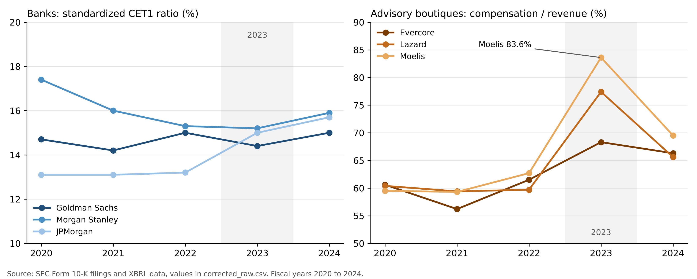

# Strategic Capital Allocation in Investment Banking
### A Comparative Longitudinal Study of Major U.S. Firms (2020 to 2024)

[](https://opensource.org/licenses/MIT)
[](#)
[](https://www.sec.gov/edgar)

> **An independent high-school student research project analyzing how leading Wall Street investment banks and advisory boutiques allocated capital between balance-sheet retention, reinvestment, and shareholder distributions during periods of macroeconomic volatility.**

---

**Author:** Ege Umut Can, FMV Işık High School, Istanbul (Class of 2027)



## 1. Research Question

> *"How do major investment-banking firms allocate capital between business investment, capital retention, and shareholder distributions, and how are these patterns associated with subsequent business performance?"*

When studying introductory economics and corporate finance, capital allocation is often taught through simple textbook formulas. Yet in the real financial world, executive leadership faces difficult trade-offs: *Should excess cash be returned to shareholders via buybacks and dividends, held on the balance sheet as a regulatory cushion, or reinvested into employee compensation and technology?*

Between 2020 and 2024, the global economy witnessed a rapid sequence of shocks: the initial COVID-19 pandemic shutdown and emergency stimulus (2020), an explosive boom in corporate mergers and IPOs (2021), followed by the steepest Federal Reserve interest-rate hiking cycle in four decades (2022 to 2023), and subsequent market stabilization (2024).

To understand how real-world financial institutions reacted to these rapid shifts, I hand-collected and analyzed financial data from **40 official SEC Form 10-K annual reports** across eight prominent Wall Street institutions.

## 2. Data & Methodology

- **Data:** 40 SEC Form 10-K annual reports (eight firms, fiscal years 2020 to 2024). Every value used in the results was re-collected from the filings and from XBRL data at data.sec.gov; each row in `corrected_raw.csv` has a source URL.
- **Panels:** the firms are split into two groups so that different business models are not compared directly.

To avoid comparing fundamentally incomparable institutions, the eight firms were grouped into two distinct analytical panels:

```text
┌───────────────────────────────────────┐       ┌───────────────────────────────────────┐
│     PANEL A: Bank Holding Companies   │       │     PANEL B: Independent Boutiques    │
├───────────────────────────────────────┤       ├───────────────────────────────────────┤
│ • The Goldman Sachs Group (GS)        │       │ • Evercore Inc. (EVR)                 │
│ • Morgan Stanley (MS)                 │       │ • Lazard, Inc. (LAZ)                  │
│ • JPMorgan Chase & Co. (JPM)          │       │ • Moelis & Company (MC)               │
│ • Stifel Financial Corp. (SF)         │       │                                       │
│                                       │       │ Standalone Context:                   │
│ Focus: Balance-sheet intensive,       │       │ • Jefferies Financial Group (JEF)     │
│ subject to Federal Reserve stress     │       │                                       │
│ tests and strict CET1 solvency rules. │       │ Focus: Asset-light advisory models,   │
└───────────────────────────────────────┘       │ compensation-driven, high cash payout.│
                                                └───────────────────────────────────────┘
```

- **Method:** ratio analysis by firm and year (payout, CET1, compensation and operating margin), then lagged Pearson correlations (year t against year t+1) within each panel.
- **Stance:** the study describes patterns and associations. It does not claim cause and effect.

## 3. Key Empirical Findings

> **Data correction (November 2026).** The first version of this dataset contained transcription errors. I re-collected every variable used in the results from SEC filings (10-K statements and XBRL data at data.sec.gov) and rebuilt the paper, tables and charts. The verified values, with a source URL for each, are in `corrected_raw.csv`; the recomputed tests are in `corrected_correlations.csv`; the new charts are in `CHARTS_V2/`. The original files are kept for transparency but should not be used.

1. **$233.3 billion returned to shareholders:** $113.9 billion in dividends and $119.5 billion in share repurchases across the eight firms, 2020 to 2024.
2. **Dividends steady, buybacks volatile:** bank dividends rose over the period, while buybacks jumped in 2021 and then moved differently at each firm.
3. **Regulatory capital (Panel A):** Goldman Sachs, Morgan Stanley and JPMorgan kept standardized CET1 ratios between 13.1% and 17.4%.
4. **Pay at the advisory boutiques (Panel B):** from 2022 to 2023 revenue fell 9% to 13%, while compensation fell 2.4% at Evercore and rose about 16% to 18% at Lazard and Moelis. GAAP compensation reached 68.3% (Evercore), 77.4% (Lazard) and 83.6% (Moelis) of revenue, and Lazard and Moelis made operating losses.
5. **Lagged associations (t to t+1):** buybacks had no clear link with next-year return on equity in Panel A (r = -0.246, p = 0.359, N = 16). With 24 tests and small samples, none of the results show cause and effect.

## 4. Limitations

- **Small samples:** each lagged test has 12 to 16 firm-year pairs, and 24 main tests were run (plus robustness checks), so some "significant" results would appear by chance.
- **Few firms, short period:** eight firms over five years, all US-listed. The results may not hold for European banks or private advisory firms.
- **Different metrics by panel:** CET1 only exists for the bank holding companies, and the boutiques' compensation ratios follow each firm's own reporting, so the two panels cannot be ranked against each other.
- **Correction history:** the first dataset had transcription errors. The original files are kept for transparency but should not be used.
- **Next question:** the numbers show what the firms did in 2023, not why. Earnings-call transcripts or proxy statements would be needed to see how managers explained keeping pay high while revenue fell.

## 5. Repository Structure

```text
strategic-capital-allocation-investment-banking/
├── README.md
├── FINAL_PAPER.md / .pdf / .docx         # Research paper (rebuilt on the corrected data)
├── FINAL_PAPER_SOURCE_MAP.csv            # Where each number in the paper comes from
├── corrected_raw.csv                     # Verified values with a source URL for each (use this)
├── corrected_derived.csv                 # Derived values (cash returned, payout ratio, net cash)
├── corrected_correlations.csv            # Recomputed lagged correlation tests
├── corrected_panel_values.csv            # Firm-year pairs behind each test
├── CHARTS_V2/                            # Charts built from the corrected data
├── PHASE0_CANDIDATE_UNIVERSE.csv         # How the eight firms were chosen
├── PHASE2_DATA_DICTIONARY.csv            # Variable definitions
└── PHASE3_*.csv, PHASE4_*, PHASE4_CHARTS/ # Original (uncorrected) files, kept for transparency only
```

## Transparency Note

As an independent 12th-grade student researcher, I formulated the research question, collected and checked the SEC Form 10-K disclosures across all eight institutions, and conducted the comparative financial analysis. I used AI coding assistants to assist with data structuring, generating charts, and refining written drafts. All final empirical observations, interpretations, and conclusions are my own.

## Citation

```bibtex
@misc{can2026capitalallocation,
  author       = {Ege Umut Can},
  title        = {Strategic Capital Allocation in Investment Banking: A Comparative Longitudinal Study of Major U.S. Firms, 2020 to 2024},
  year         = {2026},
  school       = {FMV Işık High School, Istanbul},
  howpublished = {\url{https://github.com/ege211/strategic-capital-allocation-investment-banking}}
}
```

## License

This project is licensed under the [MIT License](LICENSE).
